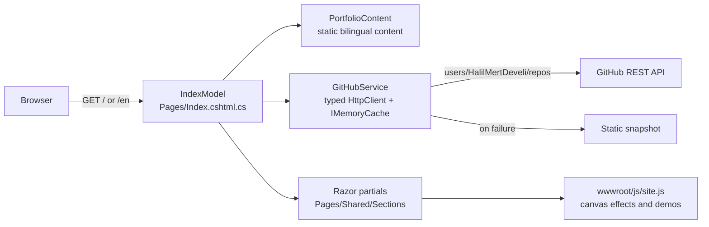

<div align="center">

# Halil Mert Develi — Portfolio

**Bilingual portfolio site with playable product demos, built on ASP.NET Core 8 Razor Pages and vanilla JavaScript.**
<br/>
<sub>ASP.NET Core 8 Razor Pages ve saf JavaScript ile geliştirilmiş, oynanabilir ürün demoları içeren iki dilli portföy sitesi.</sub>

<br/><br/>

[](Portfolio.csproj)
[](Pages)
[](wwwroot/js/site.js)
[](vercel.json)
[](https://halilmertdeveli.com.tr)

<a href="https://halilmertdeveli.com.tr"><b>halilmertdeveli.com.tr</b></a>

<p><a href="#english">English</a> · <a href="#turkce">Türkçe</a></p>


</div>

| | |
|---|---|
| **Type · Tür** | Personal portfolio web site · Kişisel portföy web sitesi |
| **Status · Durum** | Live on a custom domain · Özel alan adında yayında |
| **Stack · Teknoloji** | .NET 8, ASP.NET Core Razor Pages, C#, hand-written CSS, vanilla JavaScript (canvas), GitHub REST API, Docker, Vercel |
| **Languages · Diller** | Turkish at `/`, English at `/en` · Türkçe `/`, İngilizce `/en` |
| **Dependencies · Bağımlılıklar** | No NuGet packages, no front-end framework or build step · NuGet paketi, ön yüz framework'ü veya build adımı yok |
| **Tests / CI · Test / CI** | None; manual browser checks · Yok; tarayıcıda elle kontrol |

---

<a id="english"></a>

## English

- [Overview](#en-overview)
- [Problem and solution](#en-problem)
- [Features](#en-features)
- [Tech stack](#en-stack)
- [Architecture](#en-architecture)
- [Repository structure](#en-structure)
- [Content and data](#en-data)
- [Getting started](#en-setup)
- [Deployment](#en-deploy)
- [Testing and CI](#en-testing)
- [Engineering notes](#en-notes)
- [Limitations](#en-limitations)
- [Project status](#en-status)
- [Contact](#en-contact)

<a id="en-overview"></a>
### Overview

This repository is the source of [halilmertdeveli.com.tr](https://halilmertdeveli.com.tr), the portfolio of software engineer Halil Mert Develi. It is a single Razor page rendered in Turkish (`/`) or English (`/en`) from one content model, with no front-end framework. Each featured product gets a panel with a small in-browser demo, an engineering detail sheet and honest status labels.

<a id="en-problem"></a>
### Problem and solution

**Problem.** A list of repositories tells a recruiter little, and most of the owner's product work lives in private repositories.

**Solution.** A site that explains each product in plain language, separates shipped work from planned work, and lets visitors try a small demo of each product instead of only reading about it.

<a id="en-features"></a>
### Features

| Area | Capability | Where |
|---|---|---|
| Hero | "LED wall": the name is rasterised onto a dot-matrix canvas that reacts to the pointer and clicks | `Pages/Shared/Sections/_Wall.cshtml`, `wwwroot/js/site.js` |
| Recruiter brief | "30-second brief" dialog with focus, stack, products and contact details; a button prints it / saves it as PDF | `Sections/_Brief.cshtml` |
| Product panels | Four featured products (Mevora, LED B2B Platform, Motor, LED Support Bot) with metrics, problem, contribution, highlights, built vs. roadmap lists | `Sections/_Product.cshtml`, `Services/PortfolioContent.cs` |
| Demos | Music-match calculator (Mevora), LED wall configurator (LED B2B Platform), fitment search (Motor), scripted support conversation (LED Support Bot) | `Sections/_DemoMevora.cshtml`, `_DemoWall.cshtml`, `_DemoMotor.cshtml`, `_DemoBot.cshtml` |
| More projects | Filterable project grid, animated with the View Transitions API where supported | `Sections/_MoreProjects.cshtml` |
| GitHub section | Public repository data from the GitHub REST API, cached, with a static fallback | `Sections/_GitHub.cshtml`, `Services/GitHubService.cs` |
| About, skills, journey, contact | Profile, skill groups, timeline and copy-to-clipboard email | `Sections/_About.cshtml`, `_Skills.cshtml`, `_Journey.cshtml`, `_Contact.cshtml` |
| Accessibility | Effects honour `prefers-reduced-motion`; content is visible without JavaScript (reveal animations only apply under a `.js` class) | `wwwroot/js/site.js`, `wwwroot/css/site.css` |
| SEO | Per-language title and description, canonical URL, `hreflang` alternates, schema.org `Person` + `WebSite` JSON-LD, `robots.txt`, `sitemap.xml`, Open Graph image | `Pages/Index.cshtml.cs`, `Pages/Shared/_Layout.cshtml`, `wwwroot/` |

<a id="en-stack"></a>
### Tech stack

| Area | Choice |
|---|---|
| Server | ASP.NET Core 8, Razor Pages, C# (`net8.0`, nullable enabled) |
| Front end | Hand-written CSS and vanilla JavaScript: canvas, `IntersectionObserver`, View Transitions, `<dialog>` |
| Data | Content in `Services/PortfolioContent.cs`; GitHub data from the REST API via a typed `HttpClient` and `IMemoryCache` |
| Hosting | Docker image on Vercel's container runtime, custom domain; `Dockerfile`, IIS `web.config` and an nginx example for other hosts |

<a id="en-architecture"></a>
### Architecture



*One page model, one content source, one external call. Everything interactive runs in the browser.*

Request pipeline in `Program.cs`: forwarded headers → exception handler and HSTS (non-development) → status-code pages re-executed to `/Error` → Brotli/Gzip response compression → security headers (`X-Content-Type-Options`, `Referrer-Policy`, `X-Frame-Options`, `Permissions-Policy`) → static files with long-lived caching for versioned assets → Razor Pages.

<a id="en-structure"></a>
### Repository structure

```text
Program.cs                 Hosting, compression, security headers, caching
Pages/
  Index.cshtml(.cs)        The single page; route "{lang:regex(^en$)?}"
  Shared/_Layout.cshtml    Head, meta, hreflang, JSON-LD
  Shared/Sections/         One partial per section (_Wall, _Product, _Demo*, _GitHub, ...)
Models/                    Text(tr, en) record, CaseStudy, ProjectCard, GitHubSnapshot
Services/
  PortfolioContent.cs      All page content, in both languages
  GitHubService.cs         GitHub REST client with cache and fallback snapshot
wwwroot/                   site.css, site.js, images, favicon, robots.txt, sitemap.xml
Dockerfile, Dockerfile.vercel, vercel.json   Container builds and Vercel service
web.config, deploy/        IIS config, publish script, nginx example
HOSTING.md, docs/          Custom-domain setup notes (Turkish)
```

<a id="en-data"></a>
### Content and data

- **Bilingual model.** Every string is a `Text(Tr, En)` record (`Models/PortfolioModels.cs`); `IndexModel.T(...)` picks the language, so both versions render from the same objects.
- **Built vs. planned.** `CaseStudy.Implemented` and `CaseStudy.Roadmap` are separate lists, so planned features are never shown as shipped.
- **GitHub data.** `GitHubService` calls `users/HalilMertDeveli/repos`, caches the result for 30 minutes (5 minutes for the fallback), times out after 4 seconds and falls back to a snapshot taken on 2026-10-06. A `SemaphoreSlim` prevents concurrent refreshes.
- **No database, no user input stored.** The site has no forms that post to the server and no persistence.

<a id="en-setup"></a>
### Getting started

Requires the [.NET 8 SDK](https://dotnet.microsoft.com/download/dotnet/8.0).

```bash
dotnet run --urls http://localhost:5199
```

Open http://localhost:5199 (Turkish) or http://localhost:5199/en (English). Without `--urls`, the launch profile serves http://localhost:45217. In Visual Studio, open `Portfolio.csproj` and press F5.

| Setting | Purpose |
|---|---|
| `Site__PublicBaseUrl` | Canonical URL used in meta tags, `hreflang` and JSON-LD |
| `Site__ContactEmail` | Contact address shown on the page |
| `GitHub__Token` *(optional)* | Raises the GitHub API rate limit; used on the server only, never sent to the browser |

To change content, edit `Services/PortfolioContent.cs`. Images live in `wwwroot/img/`.

<a id="en-deploy"></a>
### Deployment

- Vercel builds `Dockerfile.vercel` (declared in `vercel.json` as a container service) on every push to `main`; pull requests get preview deployments.
- The app listens on `$PORT` (default 8080) and trusts forwarded headers from the proxy.
- `Dockerfile` runs the same app on any Docker host; `web.config` and `deploy/nginx.conf.example` cover IIS and nginx reverse-proxy setups; `deploy/publish.sh` produces a Release publish folder.
- Custom-domain setup is documented in [HOSTING.md](./HOSTING.md) (Turkish).

<a id="en-testing"></a>
### Testing and CI

There is no automated test suite and no CI workflow. `dotnet build` completes with 0 warnings and 0 errors (re-checked with the .NET 8 SDK while preparing this README). Changes are otherwise checked by driving the page in a browser at desktop and phone sizes, in both languages, with reduced motion and with JavaScript disabled.

<a id="en-notes"></a>
### Engineering notes

- **One page, one model.** A single route with an optional `en` segment replaces a localization framework; the trade-off is that all content sits in one C# file.
- **Server-side GitHub token.** The optional token is attached to the server's `HttpClient` only; the browser never calls GitHub.
- **Cache-friendly assets.** Requests with an `asp-append-version` `?v=` hash get `max-age=31536000, immutable`; other static files get one day.
- **Graceful degradation.** Canvas effects pause when off-screen or when the tab is hidden, are skipped under reduced motion, and the page reads correctly without JavaScript.

<a id="en-limitations"></a>
### Limitations

- **Hand-maintained content.** Product metrics and headline numbers (commits, tests) are typed into `PortfolioContent.cs`, because most source repositories are private and cannot be read at runtime.
- **Illustrative demos.** The demos use sample data to show how each product works; they are not the private products' code.
- **No automated tests or CI.**
- **Single large script and stylesheet.** `site.js` (~860 lines) and `site.css` (~2,700 lines) are hand-written without modules or a build step.
- **Leftover helper script.** `scripts/publish-github.sh` targets a different repository name and puts a token into a git remote URL; it is not needed for the current Vercel setup.
- **No license file.** All rights reserved unless a license is added.

<a id="en-status"></a>
### Project status

**Live** at [halilmertdeveli.com.tr](https://halilmertdeveli.com.tr), deployed from `main`. The commit history includes AI-assisted commits (Cursor agent, Claude).

<a id="en-contact"></a>
### Contact

**Halil Mert Develi** · Istanbul — [halilmertdeveliii@gmail.com](mailto:halilmertdeveliii@gmail.com) · [GitHub](https://github.com/HalilMertDeveli) · [LinkedIn](https://www.linkedin.com/in/halil-mert-develi-00983a225/)

<p align="right"><a href="#english">Back to top</a> · <a href="#turkce">Türkçe</a></p>

---

<a id="turkce"></a>

## Türkçe

- [Genel bakış](#tr-genel)
- [Problem ve çözüm](#tr-problem)
- [Özellikler](#tr-ozellikler)
- [Teknoloji yığını](#tr-teknoloji)
- [Mimari](#tr-mimari)
- [Depo yapısı](#tr-yapi)
- [İçerik ve veri](#tr-veri)
- [Kurulum](#tr-kurulum)
- [Yayına alma](#tr-yayin)
- [Test ve CI](#tr-test)
- [Mühendislik notları](#tr-notlar)
- [Sınırlamalar](#tr-sinirlamalar)
- [Proje durumu](#tr-durum)
- [İletişim](#tr-iletisim)

<a id="tr-genel"></a>
### Genel bakış

Bu depo, yazılım mühendisi Halil Mert Develi'nin portföyü olan [halilmertdeveli.com.tr](https://halilmertdeveli.com.tr) sitesinin kaynak kodudur. Site, tek bir içerik modelinden Türkçe (`/`) veya İngilizce (`/en`) olarak render edilen tek bir Razor sayfasıdır ve ön yüz framework'ü kullanmaz. Öne çıkan her ürün için tarayıcıda çalışan küçük bir demo, bir mühendislik detay sayfası ve dürüst durum etiketleri bulunur.

<a id="tr-problem"></a>
### Problem ve çözüm

**Problem.** Bir depo listesi işe alım uzmanına pek bir şey anlatmaz; ayrıca geliştiricinin ürün çalışmalarının çoğu özel (private) depolardadır.

**Çözüm.** Her ürünü sade bir dille anlatan, tamamlanmış işleri planlananlardan ayıran ve ziyaretçinin yalnızca okumak yerine her ürünün küçük bir demosunu denemesini sağlayan bir site.

<a id="tr-ozellikler"></a>
### Özellikler

| Alan | Yetenek | Konum |
|---|---|---|
| Giriş bölümü | "LED duvar": isim, imlece ve tıklamalara tepki veren nokta matrisli bir canvas üzerine çizilir | `Pages/Shared/Sections/_Wall.cshtml`, `wwwroot/js/site.js` |
| İşe alım özeti | Odak, teknoloji, ürünler ve iletişim bilgilerini içeren "30 saniyelik özet" penceresi; bir düğmeyle yazdırılabilir / PDF olarak kaydedilebilir | `Sections/_Brief.cshtml` |
| Ürün panelleri | Dört öne çıkan ürün (Mevora, LED B2B Platform, Motor, LED Support Bot): metrikler, problem, katkı, öne çıkanlar, tamamlanan ve yol haritası listeleri | `Sections/_Product.cshtml`, `Services/PortfolioContent.cs` |
| Demolar | Müzik uyumu hesaplayıcı (Mevora), LED duvar yapılandırıcı (LED B2B Platform), parça uyumluluk araması (Motor), senaryolu destek konuşması (LED Support Bot) | `Sections/_DemoMevora.cshtml`, `_DemoWall.cshtml`, `_DemoMotor.cshtml`, `_DemoBot.cshtml` |
| Diğer projeler | Desteklenen tarayıcılarda View Transitions API ile animasyonlu, filtrelenebilir proje ızgarası | `Sections/_MoreProjects.cshtml` |
| GitHub bölümü | GitHub REST API'den gelen, önbelleğe alınan ve statik yedeği olan herkese açık depo verileri | `Sections/_GitHub.cshtml`, `Services/GitHubService.cs` |
| Hakkımda, yetenekler, yolculuk, iletişim | Profil, yetenek grupları, zaman çizelgesi ve panoya kopyalanabilen e-posta | `Sections/_About.cshtml`, `_Skills.cshtml`, `_Journey.cshtml`, `_Contact.cshtml` |
| Erişilebilirlik | Efektler `prefers-reduced-motion` tercihine uyar; içerik JavaScript olmadan da görünür (görünme animasyonları yalnızca `.js` sınıfı altında uygulanır) | `wwwroot/js/site.js`, `wwwroot/css/site.css` |
| SEO | Dile göre başlık ve açıklama, canonical URL, `hreflang` alternatifleri, schema.org `Person` + `WebSite` JSON-LD, `robots.txt`, `sitemap.xml`, Open Graph görseli | `Pages/Index.cshtml.cs`, `Pages/Shared/_Layout.cshtml`, `wwwroot/` |

<a id="tr-teknoloji"></a>
### Teknoloji yığını

| Alan | Tercih |
|---|---|
| Sunucu | ASP.NET Core 8, Razor Pages, C# (`net8.0`, nullable açık) |
| Ön yüz | Elle yazılmış CSS ve saf JavaScript: canvas, `IntersectionObserver`, View Transitions, `<dialog>` |
| Veri | İçerik `Services/PortfolioContent.cs` içinde; GitHub verisi typed `HttpClient` ve `IMemoryCache` ile REST API'den |
| Barındırma | Vercel container runtime üzerinde Docker imajı ve özel alan adı; diğer ortamlar için `Dockerfile`, IIS `web.config` ve nginx örneği |

<a id="tr-mimari"></a>
### Mimari


*Tek page model, tek içerik kaynağı, tek dış çağrı. Etkileşimli her şey tarayıcıda çalışır.*

`Program.cs` içindeki istek hattı: forwarded header'lar → hata yakalayıcı ve HSTS (geliştirme ortamı dışında) → `/Error` sayfasına yeniden yönlendirilen durum kodu sayfaları → Brotli/Gzip yanıt sıkıştırma → güvenlik başlıkları (`X-Content-Type-Options`, `Referrer-Policy`, `X-Frame-Options`, `Permissions-Policy`) → sürümlenmiş dosyalar için uzun süreli önbellekli statik dosyalar → Razor Pages.

<a id="tr-yapi"></a>
### Depo yapısı

```text
Program.cs                 Barındırma, sıkıştırma, güvenlik başlıkları, önbellek
Pages/
  Index.cshtml(.cs)        Tek sayfa; route "{lang:regex(^en$)?}"
  Shared/_Layout.cshtml    Head, meta, hreflang, JSON-LD
  Shared/Sections/         Her bölüm için bir partial (_Wall, _Product, _Demo*, _GitHub, ...)
Models/                    Text(tr, en) record'u, CaseStudy, ProjectCard, GitHubSnapshot
Services/
  PortfolioContent.cs      Sayfanın tüm içeriği, iki dilde
  GitHubService.cs         Önbellekli ve yedek anlık görüntülü GitHub REST istemcisi
wwwroot/                   site.css, site.js, görseller, favicon, robots.txt, sitemap.xml
Dockerfile, Dockerfile.vercel, vercel.json   Container build'leri ve Vercel servisi
web.config, deploy/        IIS yapılandırması, publish betiği, nginx örneği
HOSTING.md, docs/          Özel alan adı kurulum notları (Türkçe)
```

<a id="tr-veri"></a>
### İçerik ve veri

- **İki dilli model.** Her metin bir `Text(Tr, En)` record'udur (`Models/PortfolioModels.cs`); `IndexModel.T(...)` dili seçer, böylece iki sürüm de aynı nesnelerden render edilir.
- **Tamamlanan ve planlanan.** `CaseStudy.Implemented` ve `CaseStudy.Roadmap` ayrı listelerdir; planlanan özellikler hiçbir zaman tamamlanmış gibi gösterilmez.
- **GitHub verisi.** `GitHubService`, `users/HalilMertDeveli/repos` adresini çağırır, sonucu 30 dakika (yedek veri için 5 dakika) önbellekte tutar, 4 saniyede zaman aşımına uğrar ve 2026-10-06 tarihli anlık görüntüye geri döner. Bir `SemaphoreSlim`, eşzamanlı yenilemeleri engeller.
- **Veritabanı yok, kullanıcı verisi saklanmaz.** Sitede sunucuya veri gönderen form veya kalıcı depolama yoktur.

<a id="tr-kurulum"></a>
### Kurulum

[.NET 8 SDK](https://dotnet.microsoft.com/download/dotnet/8.0) gereklidir.

```bash
dotnet run --urls http://localhost:5199
```

http://localhost:5199 (Türkçe) veya http://localhost:5199/en (İngilizce) adresini açın. `--urls` verilmezse launch profili http://localhost:45217 adresini kullanır. Visual Studio'da `Portfolio.csproj` dosyasını açıp F5'e basabilirsiniz.

| Ayar | Amaç |
|---|---|
| `Site__PublicBaseUrl` | Meta etiketleri, `hreflang` ve JSON-LD'de kullanılan canonical URL |
| `Site__ContactEmail` | Sayfada gösterilen iletişim adresi |
| `GitHub__Token` *(isteğe bağlı)* | GitHub API istek sınırını yükseltir; yalnızca sunucuda kullanılır, tarayıcıya gönderilmez |

İçeriği değiştirmek için `Services/PortfolioContent.cs` dosyasını düzenleyin. Görseller `wwwroot/img/` altındadır.

<a id="tr-yayin"></a>
### Yayına alma

- Vercel, `main` dalına yapılan her push'ta `Dockerfile.vercel` dosyasını derler (`vercel.json` içinde container servisi olarak tanımlı); pull request'ler önizleme yayını alır.
- Uygulama `$PORT` (varsayılan 8080) üzerinde dinler ve proxy'den gelen forwarded header'lara güvenir.
- `Dockerfile` aynı uygulamayı herhangi bir Docker sunucusunda çalıştırır; `web.config` ve `deploy/nginx.conf.example` IIS ve nginx reverse-proxy kurulumlarını kapsar; `deploy/publish.sh` Release publish klasörü üretir.
- Özel alan adı kurulumu [HOSTING.md](./HOSTING.md) dosyasında anlatılır.

<a id="tr-test"></a>
### Test ve CI

Otomatik test veya CI workflow'u yoktur. `dotnet build` 0 uyarı ve 0 hatayla tamamlanıyor (bu README hazırlanırken .NET 8 SDK ile yeniden denendi). Bunun dışında değişiklikler, sayfa tarayıcıda masaüstü ve telefon boyutlarında, iki dilde, azaltılmış hareket tercihiyle ve JavaScript kapalıyken gezilerek kontrol edilir.

<a id="tr-notlar"></a>
### Mühendislik notları

- **Tek sayfa, tek model.** İsteğe bağlı `en` segmenti olan tek bir route, yerelleştirme framework'ünün yerini alır; bedeli, tüm içeriğin tek bir C# dosyasında durmasıdır.
- **Sunucu tarafı GitHub token'ı.** İsteğe bağlı token yalnızca sunucunun `HttpClient`'ına eklenir; tarayıcı GitHub'ı hiç çağırmaz.
- **Önbellek dostu dosyalar.** `asp-append-version` ile `?v=` hash'i taşıyan istekler `max-age=31536000, immutable` alır; diğer statik dosyalar bir gün önbellekte kalır.
- **Kademeli bozulma.** Canvas efektleri ekran dışındayken veya sekme gizliyken durur, azaltılmış hareket tercihinde atlanır ve sayfa JavaScript olmadan da doğru okunur.

<a id="tr-sinirlamalar"></a>
### Sınırlamalar

- **Elle güncellenen içerik.** Ürün metrikleri ve öne çıkan sayılar (commit, test) `PortfolioContent.cs` içine elle yazılır; kaynak depoların çoğu özel olduğu için çalışma anında okunamaz.
- **Temsili demolar.** Demolar her ürünün nasıl çalıştığını örnek verilerle gösterir; özel ürünlerin kodu değildir.
- **Otomatik test veya CI yok.**
- **Tek büyük betik ve stil dosyası.** `site.js` (~860 satır) ve `site.css` (~2.700 satır) modül veya build adımı olmadan elle yazılmıştır.
- **Artık yardımcı betik.** `scripts/publish-github.sh` farklı bir depo adını hedefler ve token'ı git remote URL'ine yazar; mevcut Vercel kurulumu için gerekli değildir.
- **Lisans dosyası yok.** Bir lisans eklenene kadar tüm hakları saklıdır.

<a id="tr-durum"></a>
### Proje durumu

**Yayında:** [halilmertdeveli.com.tr](https://halilmertdeveli.com.tr), `main` dalından yayınlanıyor. Commit geçmişi yapay zekâ destekli commit'ler de içerir (Cursor agent, Claude).

<a id="tr-iletisim"></a>
### İletişim

**Halil Mert Develi** · İstanbul — [halilmertdeveliii@gmail.com](mailto:halilmertdeveliii@gmail.com) · [GitHub](https://github.com/HalilMertDeveli) · [LinkedIn](https://www.linkedin.com/in/halil-mert-develi-00983a225/)

<p align="right"><a href="#turkce">Başa dön</a> · <a href="#english">English</a></p>
