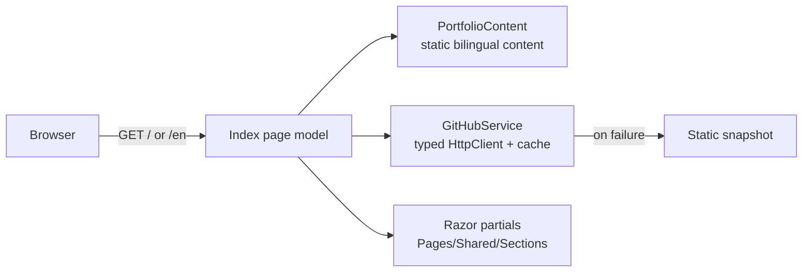

# Halil Mert Develi — Portfolio

[](https://halilmertdeveli.com.tr)
[](https://dotnet.microsoft.com/)

The source of [halilmertdeveli.com.tr](https://halilmertdeveli.com.tr): a bilingual (Turkish `/`, English `/en`) portfolio built with ASP.NET Core 8 Razor Pages and no front-end framework.

## Problem & solution

A list of repositories doesn't tell a recruiter much, and most of my product work lives in private repositories. This site presents each product in plain language with honest status labels, and lets visitors try a small demo of each one instead of only reading about it.

## Features

- **LED wall hero** — the name is rasterised onto a dot-matrix canvas that reacts to the pointer and clicks
- **30-second brief** — a dialog with focus, stack, products and contact details, printable as a PDF
- **Product panels with demos** — a music-match calculator (Mevora), an LED wall configurator (LED B2B Platform), a fitment search (Motor) and a scripted support conversation (LED Support Bot)
- **Engineering detail sheets** — problem, contribution, highlights, and built versus planned work for each product
- **Filterable project grid** and a live GitHub section fed by the GitHub API
- **Accessible by default** — every effect has a static fallback for `prefers-reduced-motion` and for visitors without JavaScript

## Tech stack

| Area | Choice |
| --- | --- |
| Server | ASP.NET Core 8, Razor Pages, C# |
| Front end | Hand-written CSS and vanilla JavaScript (canvas, IntersectionObserver, View Transitions) |
| Data | Content in `Services/PortfolioContent.cs`; GitHub data from the REST API with a 30-minute memory cache and a static fallback |
| Hosting | Docker container on Vercel, custom domain |

## Architecture



- Every string is a `Text(tr, en)` record, so both languages render from one model.
- Roadmap items live in separate lists from finished work, so planned features are never shown as shipped.
- `Program.cs` adds response compression, long-lived caching for versioned assets, security headers and a 404 page.

## Getting started

Requires the [.NET 8 SDK](https://dotnet.microsoft.com/download/dotnet/8.0).

```bash
dotnet run --urls http://localhost:5199
```

Open http://localhost:5199 (Turkish) or http://localhost:5199/en (English). In Visual Studio, open `Portfolio.csproj` and press F5.

### Configuration

| Setting | Purpose |
| --- | --- |
| `Site__PublicBaseUrl` | Canonical URL used in meta tags and the sitemap |
| `GitHub__Token` *(optional)* | Raises the GitHub API rate limit; used on the server only |

To change content, edit `Services/PortfolioContent.cs`. Images live in `wwwroot/img/`.

## Testing

There is no automated test suite. Changes are checked by building in Release and driving the page in a headless browser at desktop and phone sizes, in both languages, with reduced motion and with JavaScript disabled.

## Deployment

Vercel builds `Dockerfile.vercel` (configured in `vercel.json`) on every push to `main`, and pull requests get preview deployments. `Dockerfile` runs the same app on any Docker host. Domain setup is documented in [HOSTING.md](./HOSTING.md).

## Project status

Live at [halilmertdeveli.com.tr](https://halilmertdeveli.com.tr).

## Limitations

- Content and the headline numbers (commits, tests) are maintained by hand, because most of the source repositories are private.
- The product demos use illustrative data; they show how each product works, not the private code itself.

## Contact

**Halil Mert Develi** · Istanbul — [halilmertdeveliii@gmail.com](mailto:halilmertdeveliii@gmail.com) · [GitHub](https://github.com/HalilMertDeveli) · [LinkedIn](https://www.linkedin.com/in/halil-mert-develi-00983a225/)
